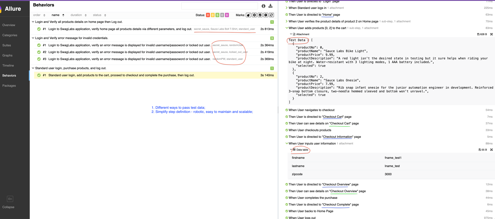
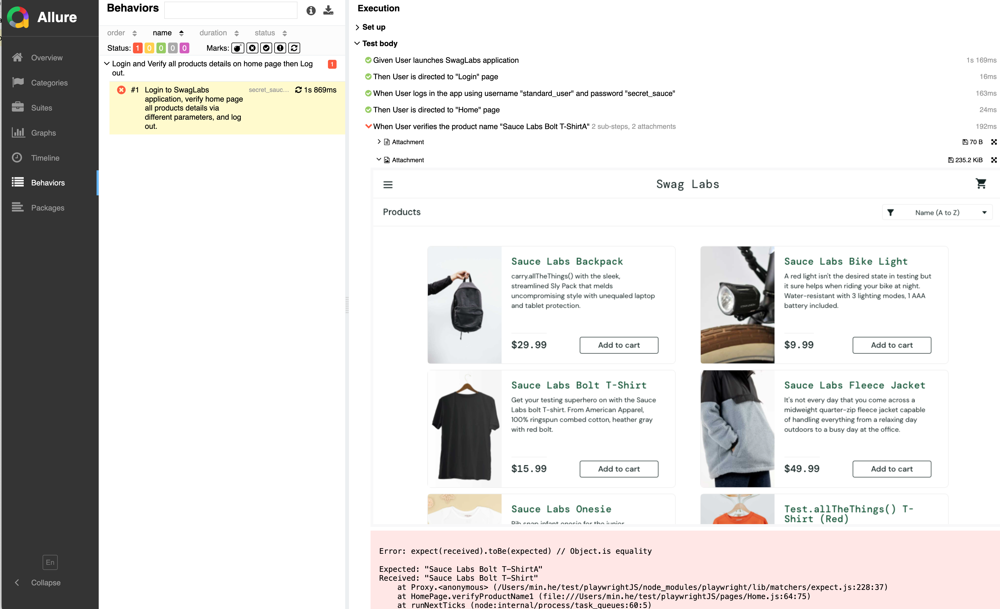
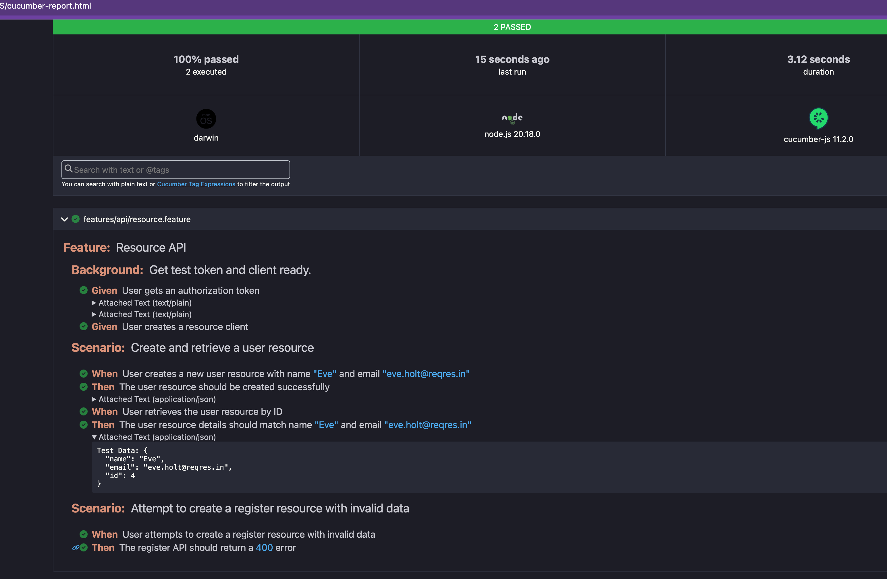
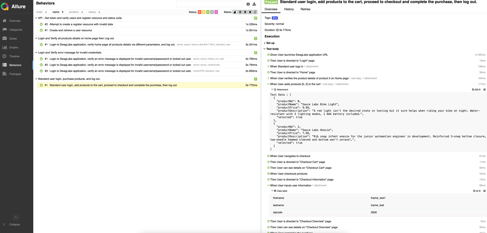

# TypeScript Test Automation with Playwright, Cucumber and Allure

This demonstration project compares two ways to build E2E and API tests with
TypeScript, Playwright, and Allure: a Cucumber-based suite and a separate
Playwright Test suite. The suites share page objects and test data.

## Test runners

| Command | Runner | Tests and reporting |
| --- | --- | --- |
| `npm test` | Cucumber | Runs E2E `.feature` files. TypeScript step definitions use Playwright to control the browser; `allure-cucumberjs` produces Allure results. |
| `npm run test:pw` | Playwright Test | Runs `.spec.ts` tests directly, without Cucumber feature files. `allure-playwright` produces Allure results. |

The Cucumber suite also has a separate API command, `npm run test:api`, which
uses Axios. For more about the Playwright Test suite, see its
[README](./playwrightTestRunner/README.md).

## Project structure

```text
├── api/                    # Axios clients, models, and helpers
├── configs/                # Shared settings and Cucumber configurations
├── data/                   # CSV test data and helpers
├── features/
│   ├── api/                # Cucumber API features
│   └── e2e/                # Cucumber browser features
├── pages/                  # Shared Playwright page objects
├── playwrightTestRunner/   # Playwright Test configuration and specs
├── step-definitions/       # Cucumber steps and hooks
└── tests/                  # TypeScript helper tests
```

## Test coverage

- **Browser:** login, invalid credentials, product details, cart, checkout, and logout on [Sauce Demo](https://www.saucedemo.com/).
- **API:** authentication, creating and retrieving a user resource, and invalid registration requests against [ReqRes](https://reqres.in/).
- **Test data:** Cucumber step arguments and data tables, CSV files, and generated data.

The API examples use a fixed existing user ID for retrieval rather than reading
back the newly created resource. They depend on the external service and its
current data and authentication requirements.

## Prerequisites and setup

- Node.js 22, 24, or 26 and later, with npm 10 or later.
- Java for generating Allure reports.
- Network access to download browsers and reach the test applications.

From the project root:

```sh
npm ci
npx playwright install chromium firefox webkit
```

The configured Playwright Test projects use Firefox, mobile Chromium, mobile
WebKit, and separately installed Google Chrome. The Cucumber E2E suite uses
Playwright Chromium by default, including its headless shell.

If browser downloads fail but Google Chrome is installed, run the Cucumber E2E
suite with that browser:

```sh
PLAYWRIGHT_BROWSER_CHANNEL=chrome npm test
```

To run only the Google Chrome Playwright Test project:

```sh
npm run test:pw -- --project="Google Chrome"
```

## Configuration

- `configs/config.default.json`: Sauce Demo URL, test credentials, timeout, and headless setting.
- `configs/config.api.json`: ReqRes URL and example user data.
- `configs/cucumber-*.ts`: feature paths, step definitions, hooks, and reporting for the Cucumber commands.
- `playwrightTestRunner/configs/playwright.config.ts`: Playwright Test projects, reporters, and execution settings.

Cucumber loads TypeScript using `tsx`; Playwright Test runs its TypeScript specs
directly. Run `npm run typecheck` to type-check the project without emitting
JavaScript.

## Run tests

Run commands from the project root:

| Command | Description | Output |
| --- | --- | --- |
| `npm test` | Run Cucumber E2E features. | Allure results in `allure-results/`. |
| `npm run test:local` | Run Cucumber E2E features with console progress. | `cucumber-report.html`. |
| `npm run test:api` | Run Cucumber API features. | `cucumber-report.html`. |
| `npm run test:pw` | Run Playwright Test E2E and API specs across configured projects. | Allure results and a Playwright HTML report. |
| `npm run test:unit` | Run TypeScript helper tests. | Console results. |
| `npm run typecheck` | Type-check project source and tests. | Console results. |

The Cucumber API tests send a login token as a bearer token. ReqRes has rejected
this authentication on `/api/*` endpoints with HTTP 401 and requested an
`x-api-key`, so the API scenarios may require an appropriate ReqRes
authentication setup. The Cucumber resource scenario also retrieves a fixed
user ID; its expected feature data must match that user's current data.

### Run a specific Cucumber feature

Add a unique tag above the feature's `Feature:` line, such as `@loginOnly`, then
select it:

```sh
PLAYWRIGHT_BROWSER_CHANNEL=chrome npm run test:local -- --tags "@loginOnly"
```

Omit `PLAYWRIGHT_BROWSER_CHANNEL=chrome` to use Playwright's installed Chromium.
Any other feature or scenario with the same tag will also run. The existing
`features/e2e/loginFailure.feature` has an `@debug` tag:

```sh
PLAYWRIGHT_BROWSER_CHANNEL=chrome npm run test:local -- --tags "@debug"
```

Replace `npm run test:local` with `npm test` to produce Allure results instead
of the Cucumber HTML report.

## View reports

- **Allure:** after an Allure-enabled run, use `npm run report`. It generates and
  serves a report from `allure-results/`. Results from previous runs may remain
  in that directory and appear in the report.
- **Cucumber HTML:** open `cucumber-report.html` after `test:local` or `test:api`.
  Both commands write to the same file.
- **Playwright HTML:** after `test:pw`, run
  `npx playwright show-report playwrightTestRunner/html-results`. The configured
  reporter also attempts to open the report automatically.

Generated reports and results are ignored by Git.

## Example screenshots

### [Passed Allure Result](screenshots/allure_1.png)


### [Failed Allure Result](screenshots/allure_2.png)


### [API Cucumber Result](screenshots/api_cucumber_2.png)


### [All Allure Result](screenshots/allure_all.png)



More examples are available in the [screenshots directory](screenshots/).
