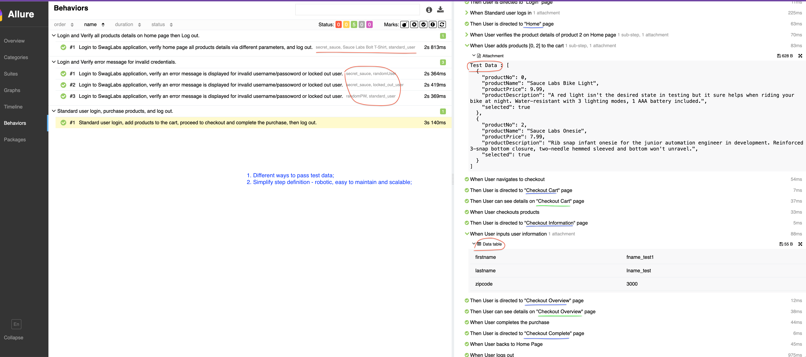
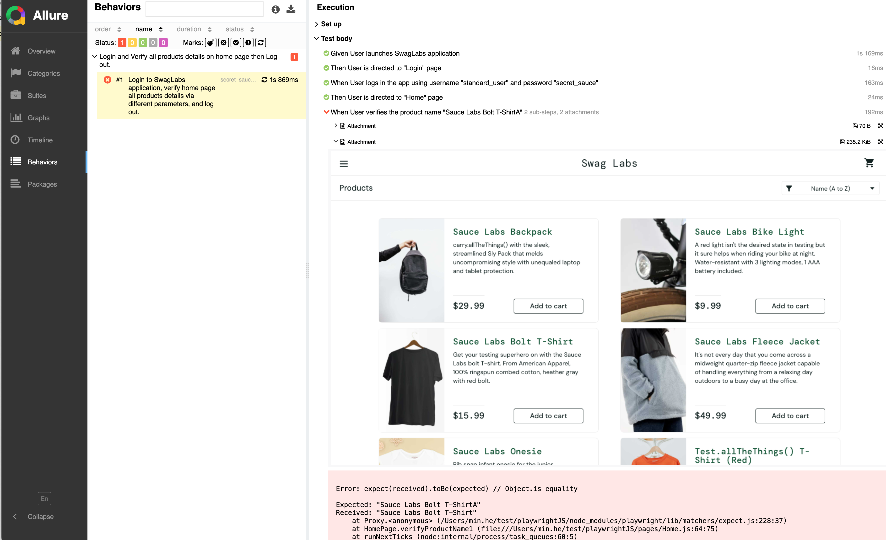
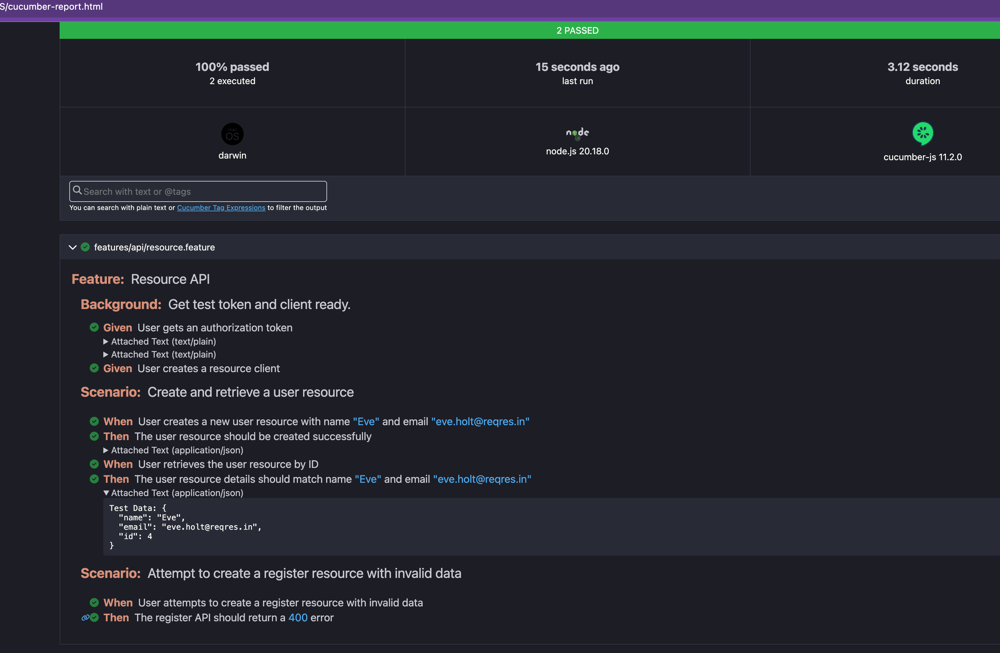
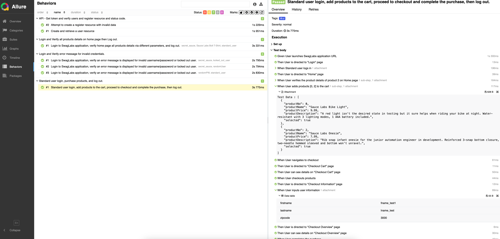

# TypeScript Test Automation with Playwright, Cucumber, Allure and AI-Assisted Authoring

This demonstration project compares two ways to build E2E and API tests with
TypeScript, Playwright, and Allure: a Cucumber-based suite and a separate
Playwright Test suite. The suites share page objects and test data.

## Test runners

| Command | Runner | Tests and reporting |
| --- | --- | --- |
| `npm test` | Cucumber | Runs E2E `.feature` files. TypeScript step definitions use Playwright to control the browser; `allure-cucumberjs` produces Allure results. |
| `npm run test:pw` | Playwright Test | Runs browser `.spec.ts` tests directly. `allure-playwright` produces Allure results. |

The Cucumber suite also has a separate API command, `npm run test:api`, which
uses Axios. For more about the Playwright Test suite, see its
[README](./playwrightTestRunner/README.md).

Optional [Playwright Test Agents](./playwrightTestRunner/README.md#optional-playwright-test-agents)
assist test planning, generation and debugging with human review; normal test
runs do not invoke them.

## Project structure

```text
├── api/                    # Axios clients, models, and helpers
├── configs/                # Shared settings and Cucumber configurations
├── data/                   # CSV test data and helpers
├── features/
│   ├── api/                # Cucumber API features
│   └── e2e/                # Cucumber browser features
├── pages/                  # Shared Playwright page objects
├── playwrightTestRunner/   # Playwright Test configuration and specs
├── step-definitions/       # Cucumber steps and hooks
└── tests/                  # TypeScript helper tests
```

## Test coverage

- **Browser:** login, invalid credentials, product details, cart, checkout, and logout on [Sauce Demo](https://www.saucedemo.com/).
- **API:** authentication, creating and retrieving a user resource, and invalid registration requests against [ReqRes](https://reqres.in/).
- **Test data:** Cucumber step arguments and data tables, CSV files, and generated data.

The Playwright browser suite runs each test across four configured projects by
default; the Chrome CI job runs only the Google Chrome project. See the
[Playwright suite README](./playwrightTestRunner/README.md#test-coverage) for
the current counts and the distinction between local regressions and Sauce Demo
tests.

The API examples use a fixed existing user ID for retrieval rather than reading
back the newly created resource. They depend on the external service and its
current data and authentication requirements.

## Prerequisites and setup

- Node.js 22, 24, or 26 and later, with npm 10 or later.
- Java for generating Allure reports.
- Network access to download browsers and reach the test applications.

From the project root:

```sh
npm ci
npx playwright install chromium firefox webkit
```

The configured Playwright Test projects use Firefox, mobile Chromium, mobile
WebKit, and separately installed Google Chrome. The Cucumber E2E suite uses
Playwright Chromium by default, including its headless shell.

If browser downloads fail but Google Chrome is installed, run the Cucumber E2E
suite with that browser:

```sh
PLAYWRIGHT_BROWSER_CHANNEL=chrome npm test
```

To run only the Google Chrome Playwright Test project:

```sh
npm run test:pw -- --project="Google Chrome"
```

## Configuration

- `configs/config.default.json`: Sauce Demo URL, test credentials, timeout, and headless setting.
- `configs/config.api.json`: ReqRes URL and example user data.
- `configs/cucumber-*.ts`: feature paths, step definitions, hooks, and reporting for the Cucumber commands.
- `playwrightTestRunner/configs/playwright.config.ts`: Playwright Test projects, reporters, and execution settings.
- `playwrightTestRunner/configs/playwright.api-live.config.ts`: the opt-in Playwright API suite.

Cucumber loads TypeScript using `tsx`; Playwright Test runs its TypeScript specs
directly. Run `npm run typecheck` to type-check the project without emitting
JavaScript.
The Cucumber browser suite applies `cucumberTimeout.default` from
`configs/config.default.json` to steps and hooks; it must be a positive integer
in milliseconds.
Malformed browser and API configuration JSON is reported without printing its
contents. Both configuration files must contain JSON objects.

## Run tests

Run commands from the project root:

| Command | Description | Output |
| --- | --- | --- |
| `npm test` | Run Cucumber E2E features. | Allure results in `allure-results/cucumber/`. |
| `npm run test:local` | Run Cucumber E2E features with console progress. | `cucumber-report.html`. |
| `npm run test:api` | Run Cucumber API features against the configured live API. | `cucumber-api-report.html`. |
| `npm run test:api:local` | Run both API suites against the local fixture; no browser or network required. | Console results. |
| `npm run test:pw` | Run Playwright browser specs across configured projects. | Allure results in `allure-results/playwright/` and a Playwright HTML report. |
| `npm run test:pw:api:live` | Run Playwright API specs once against the configured live API. | Allure results in `allure-results/playwright/` and a Playwright HTML report. |
| `npm run test:unit` | Run TypeScript helper tests. | Console results. |
| `npm run typecheck` | Type-check project source and tests. | Console results. |

The Cucumber API tests send a login token as a bearer token. ReqRes has rejected
this authentication on `/api/*` endpoints with HTTP 401 and requested an
`x-api-key`, so the API scenarios may require an appropriate ReqRes
authentication setup. The Cucumber resource scenario also retrieves a fixed
user ID; its expected feature data must match that user's current data.
Successful login responses must contain a non-empty string token.

The local API fixture returns fixed demonstration data and accepts any non-empty
login email and password. It does not validate ReqRes behavior or persist
created users. The local API command produces console output only. Live API
checks run only when their explicit commands are selected.
The local command runs both API suites even if one fails, and exits
unsuccessfully if either suite fails.
Both API runners require an absolute HTTP or HTTPS base URL and non-empty
configured login credentials; configuration errors do not print their values.

### Run a specific Cucumber feature

Add a unique tag above the feature's `Feature:` line, such as `@loginOnly`, then
select it:

```sh
PLAYWRIGHT_BROWSER_CHANNEL=chrome npm run test:local -- --tags "@loginOnly"
```

Omit `PLAYWRIGHT_BROWSER_CHANNEL=chrome` to use Playwright's installed Chromium.
Any other feature or scenario with the same tag will also run. The existing
`features/e2e/loginFailure.feature` has an `@debug` tag:

```sh
PLAYWRIGHT_BROWSER_CHANNEL=chrome npm run test:local -- --tags "@debug"
```

Replace `npm run test:local` with `npm test` to produce Allure results instead
of the Cucumber HTML report.

## Continuous integration

GitHub Actions runs type-checking, regression tests and both local API suites
on Node.js 24. A separate job installs Google Chrome and runs the Playwright
and Cucumber browser suites against Sauce Demo, so it requires network access.
Once setup succeeds, Cucumber still runs if Playwright fails. Neither job
contacts ReqRes.

If the Chrome tests fail, the workflow uploads the Playwright HTML report as
`chrome-smoke-report`, retained for seven days. It can include traces,
screenshots and action logs containing test data, including credentials. Use
only demo data and review repository artifact access before running CI. If the
Cucumber browser tests fail, their HTML report is uploaded separately as
`cucumber-chrome-report`, also retained for seven days. It can include step
arguments, credentials and failure screenshots.

## View reports

- **Allure:** use `npm run report` for a combined report, `npm run report:cucumber`
  for Cucumber only, or `npm run report:pw` for Playwright only. Each runner's
  results accumulate in its own directory, so previous runs may appear. Older
  results stored directly in `allure-results/` are not included in these reports;
  view them separately with `npx allure serve allure-results`.
- **Static Allure reports:** run `npm run report:generate` for both runners,
  `npm run report:generate:cucumber` for Cucumber, or
  `npm run report:generate:pw` for Playwright. Output goes to separate
  subdirectories of `allure-report/`. Each selected runner must have results.
  Generation refuses to overwrite an existing report; move or remove the
  specific output directory before generating it again. It does not remove
  accumulated results, so archive or remove old result files deliberately if
  you need a report for only a new run.
- **Cucumber HTML:** open `cucumber-report.html` after `test:local`, or
  `cucumber-api-report.html` after `test:api`.
- **Playwright HTML:** use `npx playwright show-report playwrightTestRunner/html-results`
  after `test:pw`, or `npx playwright show-report playwrightTestRunner/api-html-results`
  after `test:pw:api:live`. By default, reports open on failure locally, but not in CI.

Generated reports and results are ignored by Git.
Reports generated by older versions of the Cucumber API suite may contain
authentication tokens. Review and remove those reports, and rotate any real
tokens they exposed.
Use demo credentials only in feature files and test data: Cucumber reports
include step arguments, and Playwright action logs, traces and failure
screenshots may contain sensitive information.

## Example screenshots

### [Passed Allure Result](screenshots/allure_1.png)


### [Failed Allure Result](screenshots/allure_2.png)


### [API Cucumber Result](screenshots/api_cucumber_2.png)


### [All Allure Result](screenshots/allure_all.png)



More examples are available in the [screenshots directory](screenshots/).
